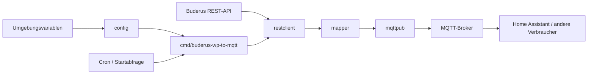

# Buderus-wp-to-mqtt

[](https://github.com/patrickhofmann0/Buderus-wp-to-mqtt/actions/workflows/ci.yml)

Leichtgewichtiger Go-Service, der die REST-API einer Buderus-Wärmepumpe regelmäßig abfragt und ihre Daten per MQTT veröffentlicht. Die konkrete API-URL und das Antwortformat hängen vom Gerät ab; dieses Projekt entdeckt keine Geräte und implementiert keine herstellerspezifische Anmeldung.

## Eigenschaften

- Auslieferung ausschließlich als Docker-Container über GHCR.
- Implementiert mit Go **1.27.3**; kein unterstütztes Go-Bibliotheksprodukt.
- Ein oder mehrere HTTP(S)-Endpunkte, Bearer-Token oder HTTP Basic Auth.
- Begrenzte Antwortgröße und konfigurierbare Netzwerk-Timeouts.
- Rekursives JSON-Feldmapping oder unveränderte Weitergabe der Antwort.
- Cron-Ausdrücke und Intervalle; überlappende Abfragen werden übersprungen.
- MQTT-Reconnect, retained Verfügbarkeitsstatus und Last Will.
- Strukturierte `slog`-Logs auf stdout, eingebettete Zeitzonendaten.
- Statisches Docker-Image auf `scratch`, CA-Zertifikate, Ausführung als UID/GID `65534`.



## Schnellstart mit Docker Compose

```sh
cp .env.example .env
# .env bearbeiten: insbesondere API_URL und MQTT_BROKER setzen.
docker compose up -d
docker compose logs -f buderus-wp-to-mqtt
```

Die Binärdatei liest **ausschließlich Umgebungsvariablen**. Sie lädt keine `.env`-Datei. Docker Compose übergibt deren Werte über `env_file`; `docker run` benötigt `--env-file`.

Die Vorlage ist eine Docker-ENV-Datei, kein Shell-Skript; nicht mit `source` einlesen. Werte mit Leerzeichen bleiben für die gemeinsame Nutzung mit Compose und `docker run --env-file` ohne Anführungszeichen, etwa `SCHEDULE=@every 60s`. Docker `--env-file` würde Anführungszeichen als Teil des Werts übernehmen. Bei einer manuellen Shell-Zuweisung dagegen separat quoten: `export SCHEDULE='@every 60s'`.

Die Compose-Konfiguration verwendet:

```yaml
services:
  buderus-wp-to-mqtt:
    image: ghcr.io/patrickhofmann0/buderus-wp-to-mqtt:latest
    build: .
    env_file: .env
    restart: unless-stopped
    mem_limit: 32m
    cpus: 0.1
    read_only: true
```

Ohne Compose:

```sh
docker run -d --name buderus-wp-to-mqtt \
  --env-file .env --read-only --memory 32m --cpus 0.1 \
  --restart unless-stopped \
  ghcr.io/patrickhofmann0/buderus-wp-to-mqtt:latest
```

`localhost` im Container bezeichnet den Container selbst. Für einen externen Broker eine erreichbare IP oder einen DNS-Namen verwenden.

### Optionaler Entwicklungsbroker

Das Compose-Profil `dev` stellt Mosquitto bereit. Seine Konfiguration wird aus `deploy/mosquitto.conf` eingebunden; der Host-Port ist ausschließlich an `127.0.0.1:1883` gebunden. Der anonyme Listener ist **nur für lokale Entwicklung** gedacht, nicht für Produktivbetrieb oder ungeschützte Netzwerke.

In `.env` setzen:

```dotenv
MQTT_BROKER=tcp://mosquitto:1883
```

Dann starten:

```sh
docker compose --profile dev up -d
```

## Konfiguration

Alle unterstützten Variablen stehen hier und in `.env.example`. Leere optionale Zugangsdaten bedeuten keine Authentifizierung. Ungültige Werte werden beim Start abgewiesen.

| Variable | Standard | Bedeutung |
| --- | --- | --- |
| `API_URL` | erforderlich, sofern `API_URLS` leer oder nicht gesetzt | Absolute HTTP(S)-URL eines Endpunkts. |
| `API_URLS` | leer | Kommagetrennte Liste `name=url`; hat nur mit nichtleerem Wert Vorrang vor `API_URL`. |
| `API_TOKEN` | leer | Bearer-Token; nicht mit Basic Auth kombinieren. |
| `API_USER` | leer | Benutzer für HTTP Basic Auth. |
| `API_PASSWORD` | leer | Basic-Auth-Passwort; erfordert `API_USER`. |
| `API_TIMEOUT` | `15s` | Positiver HTTP-Timeout als Go-Dauer. |
| `API_MAX_BODY_BYTES` | `1048576` | Maximale REST-Antwortgröße in Bytes. |
| `API_INSECURE_SKIP_VERIFY` | `false` | TLS-Zertifikatsprüfung der REST-Verbindung deaktivieren; siehe Sicherheit. |
| `MQTT_BROKER` | `tcp://localhost:1883` | Broker-URL; für verschlüsselte Verbindungen z. B. `ssl://broker.example:8883`. |
| `MQTT_CLIENT_ID` | `buderus-wp-to-mqtt` | Eindeutige MQTT-Client-ID; je Instanz unterschiedlich wählen. |
| `MQTT_USER` | leer | MQTT-Benutzername. |
| `MQTT_PASSWORD` | leer | MQTT-Passwort. |
| `MQTT_TOPIC` | `buderus/wp` | Topic-Präfix, ohne Wildcards oder NUL. |
| `MQTT_QOS` | `0` | MQTT Quality of Service für Daten: `0`, `1` oder `2`; Availability verwendet höchstens QoS `1`. |
| `MQTT_RETAIN` | `false` | Retain-Flag für Datenmeldungen. |
| `MQTT_PUBLISH_TIMEOUT` | `5s` | Positiver Timeout für MQTT-Operationen. |
| `MQTT_AVAILABILITY` | `true` | Retained `online`/`offline` auf `MQTT_TOPIC/status`, einschließlich Last Will. |
| `MAPPING` | `fields` | `fields`: JSON-Felder; `passthrough`: vollständige Antwort. |
| `SCHEDULE` | `@every 60s` | Fünffeldriger Cron-Ausdruck oder unterstützter Deskriptor. |
| `POLL_ON_START` | `true` | Zusätzlich direkt nach dem Start abfragen. |
| `TZ` | `UTC` | IANA-Zeitzone, z. B. `Europe/Berlin`. |
| `LOG_LEVEL` | `info` | `debug`, `info`, `warn` oder `error`. |
| `LOG_FORMAT` | `json` | `json` oder `text`; Ausgabe auf stdout. |

`API_URLS` zum Beispiel:

```dotenv
API_URLS=heating=http://device/api,hotwater=http://device/water
```

Namen müssen eindeutig sein und ausschließlich `[A-Za-z0-9_-]` enthalten. URLs erlauben nur `http` oder `https`, keine eingebetteten Zugangsdaten oder Fragmente. Ist `API_URLS` leer oder nicht gesetzt, wird `API_URL` verwendet. Authentifizierung und HTTP-Einstellungen gelten für alle Endpunkte gemeinsam.

Mit `API_URL` werden Daten auf `MQTT_TOPIC` beziehungsweise `MQTT_TOPIC/feld` veröffentlicht. Mit `API_URLS` lauten die Topics `MQTT_TOPIC/name` beziehungsweise `MQTT_TOPIC/name/feld`. Der Verfügbarkeitsstatus bleibt global auf `MQTT_TOPIC/status`.

### Zeitplanung

| Beispiel | Wirkung |
| --- | --- |
| `@every 60s` | Alle 60 Sekunden; Standard. |
| `*/5 * * * *` | Alle fünf Minuten. |
| `0 6 * * *` | Täglich um 06:00 Uhr in `TZ`. |
| `@hourly` | Stündlich. |
| `@daily` | Täglich um Mitternacht. |
| `@weekly`, `@monthly`, `@yearly`, `@annually`, `@midnight` | Weitere Standarddeskriptoren. |

Cron-Felder: **Minute Stunde Tag-des-Monats Monat Wochentag**; kein Sekundenfeld. Intervalle müssen positiv sein. Zeitzonendaten sind eingebettet, sodass auch das `scratch`-Image `Europe/Berlin` kennt. Sommerzeit beeinflusst kalenderbasierte Zeitpläne. Eine noch laufende Abfragerunde wird nicht parallel erneut gestartet; überlappende Ausführungen werden übersprungen, nicht aufgestaut.

## Mapping

`MAPPING=fields` erwartet genau ein JSON-Objekt. Beispiel mit `MQTT_TOPIC=buderus/wp`:

```json
{
  "temperature": {"flow": 35.5},
  "mode": "heating",
  "active": true,
  "samples": [1, 2],
  "missing": null,
  "meter": 9007199254740993
}
```

| Topic | Payload |
| --- | --- |
| `buderus/wp/active` | `true` |
| `buderus/wp/meter` | `9007199254740993` |
| `buderus/wp/missing` | `null` |
| `buderus/wp/mode` | `heating` |
| `buderus/wp/samples` | `[1,2]` |
| `buderus/wp/temperature/flow` | `35.5` |

Schlüssel werden auf jeder Objektebene sortiert und rekursiv zu Topic-Pfaden abgeflacht. Strings werden ohne JSON-Anführungszeichen übertragen; Arrays bleiben JSON, `null` wird zu `null`. Zahlen werden ohne Umwandlung in `float64` verarbeitet, ihre Präzision bleibt erhalten. Leere Objekte erzeugen keine Datenmeldung.

In Schlüsseln werden `/`, `+`, `#`, Leerzeichen und NUL durch `_` ersetzt; ein leerer Schlüssel wird `_`. Entstehen dadurch identische Topic-Pfade, schlägt das gesamte Mapping fehl, statt Werte stillschweigend zu überschreiben.

`MAPPING=passthrough` überträgt die vollständigen Antwortbytes unverändert als einzelne Meldung auf dem jeweiligen Basis-Topic; eine JSON-Antwort ist dann nicht erforderlich.

**Reserviertes Topic:** Bei aktiver Verfügbarkeitsmeldung ist `MQTT_TOPIC/status` für `online`/`offline` reserviert. Erzeugt das Mapping eine Meldung auf genau diesem Topic, lehnt die Anwendung das Mapping-Ergebnis ab, statt den Status zu überschreiben. Das betrifft beispielsweise ein JSON-Feld `status` beim Einzelendpunkt oder Passthrough für einen Mehrfachendpunkt namens `status`. Dafür andere Namen verwenden oder `MQTT_AVAILABILITY=false` setzen.

## Betrieb, Fehler und Sicherheit

- `restclient` führt HTTP-GETs aus. Nicht-2xx-Antworten ergeben einen typisierten `*restclient.StatusError` mit `Code`; übergroße Antworten werden erkannt und verworfen, nicht abgeschnitten veröffentlicht.
- API-, Mapping- und Veröffentlichungsfehler werden protokolliert. Ein späterer geplanter Durchlauf kann erneut versuchen, aktuelle Daten zu übertragen.
- MQTT-Verbindungen werden automatisch wiederhergestellt. Bei Verbindung beziehungsweise Reconnect wird retained `online` veröffentlicht; beim geordneten Beenden `offline`. Bei Verbindungsverlust übernimmt der Broker das retained Last Will `offline`.
- Datenmeldungen verwenden `MQTT_QOS`. Verfügbarkeitsmeldungen einschließlich Last Will verwenden höchstens QoS 1, also `min(MQTT_QOS, 1)`, damit ein Status nach Reconnect erneut als vollständige Meldung übertragen werden kann.
- Ohne offene Broker-Verbindung, auch während eines Reconnects, werden Datenveröffentlichungen abgewiesen. Höchstens eine Datenmeldung darf gleichzeitig in der Warteschlange beziehungsweise unbestätigt sein; es gibt keine unbegrenzte Offline-Warteschlange. Bleibt sie ausstehend, schlagen weitere Veröffentlichungen fehl, statt immer mehr Speicher zu belegen.
- Ein MQTT-Timeout oder Kontextabbruch beendet das Warten, kann eine bereits übergebene Meldung aber nicht zurückrufen: Sie kann später noch beim Broker eintreffen. Bis zur tatsächlichen Bestätigung werden weitere Datenmeldungen mit einem Pending-Fehler abgewiesen. Spätere Abfragerunden können daher fehlschlagen, statt sich anzusammeln. Availability verwendet einen separaten begrenzten Kanal; `offline` beim Beenden wird bestmöglich innerhalb des Shutdown-Zeitlimits übertragen.
- SIGINT/SIGTERM beendet die Anwendung geordnet. Logs gehen ausschließlich auf stdout; Aufbewahrung und Rotation übernimmt die Laufzeitumgebung.
- `online` bestätigt die Broker-Verbindung, **nicht** erfolgreiche oder aktuelle REST-Abfragen. Es gibt keinen Health-Flag und keinen eingebauten Healthcheck-Endpunkt: Eine reine Konfigurationsprüfung wäre kein echter Laufzeitcheck. Ohne Heartbeat beziehungsweise persistenten Erfolgszustand wäre ein separater Prozess ebenfalls kein verlässlicher Zustandsprüfer. Prozessende, Container-Restart-Policy, Brokerstatus und extern überwachte Datenaktualität nutzen.
- `.env` enthält möglicherweise Geheimnisse: nicht committen und Zugriffsrechte beschränken. Token, Passwörter und vollständige sensible Antworten gehören nicht in Logs.
- `API_INSECURE_SKIP_VERIFY=true` ist ausschließlich eine bewusste Ausnahme für lokale Geräte mit selbstsigniertem Zertifikat. Es deaktiviert die Prüfung von Zertifikat und Hostname und ermöglicht Man-in-the-Middle-Angriffe. Vertrauenswürdige Zertifikate und ein abgesichertes Netz sind vorzuziehen; die Option betrifft nicht MQTT.
- HTTP und `tcp://` verschlüsseln weder Messdaten noch Zugangsdaten. Über nicht vertrauenswürdige Netze HTTPS und MQTT mit TLS verwenden.

Das Image liegt grob bei **8–10 MB**, der RAM-Verbrauch häufig bei **5–10 MB**. Dies sind **keine Garantien**: Architektur, Go-/Bibliotheksversionen, TLS, Antwortgrößen und Mapping beeinflussen Größe und Speicherbedarf. Das Compose-Limit von 32 MB kann bei großen Antworten zu knapp sein.

## Entwicklung

Für die Nutzung ist ausschließlich Docker erforderlich, optional mit Compose. Go wird nur für die Entwicklung benötigt: Version **1.27.3**. Der Modulpfad `github.com/patrickhofmann0/Buderus-wp-to-mqtt` dient dem technischen Build; es gibt keine Veröffentlichung oder Installation als Go-Bibliothek und keine unterstützte stabile Library-API.

```sh
go build ./...
go vet ./...
go test ./... -race -cover
golangci-lint run
govulncheck ./...
```

Go-Code mit `gofmt` und `goimports` formatieren. Nach begründeten Abhängigkeitsänderungen `go mod tidy` ausführen und `go.mod` sowie `go.sum` gemeinsam prüfen. Zuerst betroffene Tests ausführen; anschließend vor einer Code-PR die bestehenden Projektprüfungen berücksichtigen. Reine Dokumentationsänderungen benötigen keine Builds oder Tests.

### Projektstruktur

```text
cmd/buderus-wp-to-mqtt/main.go  Einstieg, Wiring, Signale und Zeitplanung
config/                       ENV-Konfiguration und Validierung
restclient/                   HTTP-GET, Authentifizierung und Größenlimit
mapper/                       JSONFields, Passthrough und eigenes Mapping
mqttpub/                      MQTT-Verbindung und Veröffentlichung
deploy/mosquitto.conf          Lokaler Entwicklungsbroker
Dockerfile                    Statischer Build und scratch-Laufzeit
docker-compose.yml            Service und optionales dev-Profil
.env.example                  Vollständige Konfigurationsvorlage
AGENTS.md                     Architektur- und Entwicklungsregeln
```

Die Verzeichnisse und Go-Pakete sind Implementierungsdetails des Container-Service, keine Schnittstelle für externe Bibliotheksnutzer. Die Anwendung verbindet Konfiguration, REST, Mapping und MQTT. Der interne MQTT-Keepalive beträgt standardmäßig `30s`; dafür gibt es keine zusätzliche ENV-Variable. Weitere Vorgaben für Änderungen stehen in [AGENTS.md](AGENTS.md).
